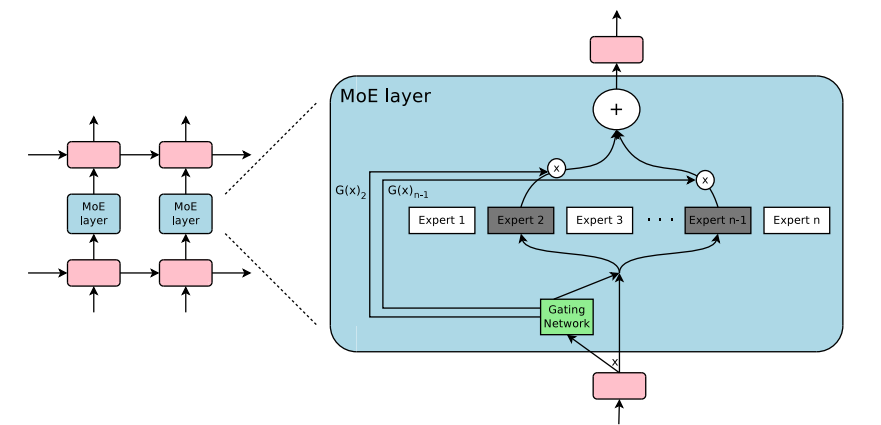

# Mixture of Experts (MoE) with PyTorch

This repository provides a simple implementation of a Mixture-of-Experts (MoE) architecture using PyTorch. The code demonstrates how to combine multiple expert networks with a gating mechanism to dynamically select or weight the contributions of each expert during inference.



## Table of Contents

- [Overview](#overview)
- [What is Mixture of Experts (MoE)?](#what-is-mixture-of-experts-moe)
- [Architecture Details](#architecture-details)
  - [Expert Networks](#expert-networks)
  - [Gating Network](#gating-network)
  - [Top-K Selection](#top-k-selection)
- [Usage](#usage)
- [Running the Code](#running-the-code)
- [Future Work](#future-work)
- [References](#references)
- [License](#license)

## Overview

Mixture of Experts (MoE) is a powerful machine learning paradigm that leverages multiple specialized sub-networks (experts) to handle different parts or aspects of a problem. A gating network is used to decide which expert(s) should be activated for a given input, allowing the model to learn a partition of the problem space. This approach is particularly useful for large-scale or diverse datasets where different subsets of data might benefit from specialized processing.

In this project, we implement a basic MoE layer in PyTorch. Each expert is a small neural network, and a gating network computes a probability distribution over the experts for each input sample. Optionally, the model supports a top‑K selection mechanism, where only the top-K experts (based on the gating scores) are used to produce the final output.

## What is Mixture of Experts (MoE)?

MoE is a model architecture that dynamically routes input data to different "experts" based on a learned gating mechanism. The key components are:

- **Experts:** These are individual models (often neural networks) that are specialized to process parts of the data.
- **Gating Network:** A network that computes a set of weights or probabilities, one for each expert, indicating the importance or relevance of each expert for a given input.
- **Aggregation:** The outputs of the experts are aggregated (typically via a weighted sum) to produce the final output.

This approach helps in managing model capacity by enabling specialization and potentially reducing computational cost if only a subset of experts is activated for each input.

## Architecture Details

### Expert Networks

Each expert (`Expert` in `model.py`) is a simple feedforward network with two linear layers:
- **First layer (`fc1`):** Maps `input_dim -> output_dim` and applies a ReLU activation.
- **Second layer (`fc2`):** Maps `output_dim -> output_dim` to produce the expert output.

### Gating Network

The gating network is a single linear layer that:
- Takes the same input as the experts.
- Outputs a set of logits corresponding to each expert.
- Applies a softmax function to convert the logits into a probability distribution over experts.

### Top-K Selection

Optionally, the MoE layer can perform **top-K selection**:
- Instead of using all expert outputs, only the top-K experts (based on the gating scores) are considered.
- The gating weights for all other experts are set to zero, ensuring that only the contributions from the most relevant experts are aggregated.

Implementation notes:
- The kept top-K weights are the original softmax probabilities; they are not renormalized to sum to 1.
- Every expert is still evaluated on every input, and the non-selected experts are multiplied by zero.
  Top-K therefore sparsifies the *mixture weights* but does not save compute. A sparse MoE would
  dispatch each input only to its selected experts.
- There is no auxiliary load-balancing loss.

## Usage

The main components of the code are defined in two classes:
- `Expert`: Defines the architecture of an individual expert.
- `MoELayer`: Combines multiple experts with a gating mechanism. It optionally uses top-K selection to sparsify the contribution of experts.

### Example Code

Below is an example of how to instantiate and use the MoE layer:

```python
import torch
from model import MoELayer  # run from the repository root

# Define input and output dimensions
input_dim = 10
output_dim = 5
batch_size = 8

# Create a random input tensor
x = torch.randn(batch_size, input_dim)

# Create the MoE layer with 4 experts and using top 2 experts per sample
moe_layer = MoELayer(input_dim, output_dim, num_experts=4, top_k=2)

# Perform a forward pass
output = moe_layer(x)
print("Output shape:", output.shape)
print("Output:", output)
```

## Running the Code

1. **Clone the Repository:**

   ```bash
   git clone https://github.com/khushwant04/mixture-of-experts.git
   cd mixture-of-experts
   ```

2. **Install Dependencies:**

   ```bash
   pip install -r requirements.txt
   ```

   Or install PyTorch following the instructions on the [official website](https://pytorch.org/).

3. **Run the Example:**

   `model.py` has a `__main__` block that runs the example above (8 samples, 4 experts, top-2):

   ```bash
   python model.py
   ```

## Future Work

Some ideas for further improvement include:
- **Deep Expert Architectures:** Experiment with deeper or more complex expert networks.
- **Dynamic Routing:** Investigate alternative gating mechanisms that can dynamically route different inputs.
- **Regularization Techniques:** Incorporate regularization strategies such as load balancing to encourage equal usage of experts.
- **Scalability:** Explore sparse MoE implementations where only a few experts are active per input to improve computational efficiency.

## References

- Jacobs, Jordan, Nowlan, Hinton, *Adaptive Mixtures of Local Experts*, Neural Computation 3(1), 1991.
- Shazeer et al., *Outrageously Large Neural Networks: The Sparsely-Gated Mixture-of-Experts Layer*, 2017. [arXiv:1701.06538](https://arxiv.org/abs/1701.06538)
- Lepikhin et al., *GShard: Scaling Giant Models with Conditional Computation and Automatic Sharding*, 2020. [arXiv:2006.16668](https://arxiv.org/abs/2006.16668)
- Fedus, Zoph, Shazeer, *Switch Transformers: Scaling to Trillion Parameter Models with Simple and Efficient Sparsity*, 2021. [arXiv:2101.03961](https://arxiv.org/abs/2101.03961)

## License

This project is licensed under the [MIT License](LICENSE).

---

Feel free to open issues or submit pull requests if you have suggestions or improvements.

